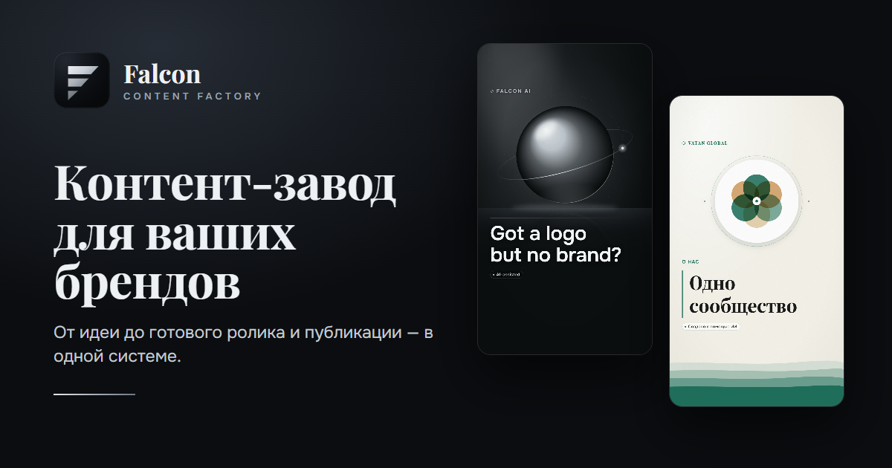

<p align="center">
  
</p>

<p align="center">
  <a href="https://gev44.github.io/falcon-content-factory/"></a>
</p>
<p align="center">
  
  
  
</p>

# Falcon Content Factory

> «Ваш собственный контент-завод: от идеи и исследования до готового ролика и публикации — для всех ваших брендов в одной системе.»
> (*Your own content factory: from idea and research to a finished video and a published post, for all your brands in one system.*)

## What it is

A bilingual (Russian / English) presentation site for **Falcon Content Factory**, a system that plans, writes, produces and publishes short vertical brand videos. The page walks a prospective client through the product and shows videos the system produced.

**For whom:** brand owners and agencies running several brands (the demo uses Falcon AI, a trucking-tech company, and Vatan Global, a community brand).
**Outcome:** the visitor sees the whole path from research to a controlled publication, watches finished reels, and can book a live 15-minute walkthrough.

## What is inside the site

- **Video walkthrough** of the system and a 5-minute "try it yourself" guide: sign in as *Owner*, see the Overview, read how the AI experts revised a video (Council and Versions tabs), open the finished reel in Studio, create a draft in a verification channel, edit a line and watch the system ask for a re-check. Nothing reaches real social accounts.
- **Six steps from idea to published post**, each with a short live-interface clip: Research, a plan for every day, copy built on facts, AI expert council (strategist, scriptwriter, fact-checker, audience critic, art director), a finished video in Studio, publishing under control.
- **A week of videos** for Falcon AI (EN, 4 reels) and Vatan Global (RU, 3 reels), each with voice-over, music and animation.
- **Made for your audience**: Russian-language reels for trucking (TMS and driver app, HR bot hiring via messengers).
- **Localization**: one video in Russian, Uzbek and English.
- **What you get**: all brands in one place, nothing goes out without approval, honest numbers (an unknown value shows "—"), three interface languages, phone and desktop, daily output without manual routine.
- **Launch in three steps**: connect accounts, approve the brand style, daily publishing.

## Tech

- Plain `index.html` with inline CSS and a small amount of vanilla JavaScript; RU / EN language switch; no build step.
- Fonts: Playfair Display and Onest (Google Fonts); dark theme with steel and gold accents.
- Media: MP4 clips with JPG posters in `media/`; PNG/SVG icons in `icons/`; Open Graph card `og.png`.
- Deployed with GitHub Pages from `main` (`.nojekyll`).
- Music in the sample videos: Kevin MacLeod (incompetech.com), CC BY 3.0.

## Run locally

```bash
git clone https://github.com/GEV44/falcon-content-factory.git
cd falcon-content-factory
python -m http.server 8000   # then open http://localhost:8000
```

Serve over HTTP (not `file://`) so the videos load correctly.

## Repo layout

```
index.html    the presentation site (RU / EN)
system.html   system entry page (noindex)
media/        reels, step clips and posters
icons/        favicon and app icons
og.png        social preview card (also the hero above)
```

## Contact

Built by **Gevorg Hovhannisyan**, ML/AI engineer in Yerevan. Want a content system like this for your brands?

- Telegram: [@hovhannisyan77](https://t.me/hovhannisyan77)
- WhatsApp: <https://wa.me/37444772541>
- Portfolio: <https://gev44.github.io>
